# EventFlow

EventFlow is a Laravel application for coordinating school and community events. Members can manage event schedules, assign and track tasks, view a personal calendar, and receive in-app notifications. Administrators have a separate platform area for managing users, events, tasks, categories, and audit history.

## Requirements

- PHP 8.3 or later with the extensions required by Laravel
- Composer
- Node.js 22.12 or later and npm
- SQLite (the default) or another database supported by Laravel

## Local setup

From the project directory:

```powershell
composer install
Copy-Item .env.example .env
php artisan key:generate
php artisan migrate
npm install
npm run build
php artisan serve
```

In another terminal, run `npm run dev` while developing frontend assets. Configure `APP_URL` to match the local application URL. The default database connection is SQLite; create `database/database.sqlite` if it does not exist before running migrations.

Alternatively, `composer run setup` runs the repository's setup script, including dependency installation, key generation, migrations, and the frontend build.

## Configuration

Set these values in `.env` as needed:

| Variable | Purpose |
| --- | --- |
| `APP_URL` | Application base URL used for generated links. |
| `APP_TIMEZONE` | Timezone used to interpret event schedules and task deadlines. Defaults to `Asia/Jakarta`. |
| `DB_CONNECTION` | Database connection; defaults to `sqlite`. |
## Accounts and administration

New users can register from the sign-in page. The registration endpoint does not accept a system role; new accounts are ordinary users.

Create the initial administrator from a trusted terminal:

```powershell
php artisan admin:provision admin@example.com
```

The command prompts for a name, a confirmed password, and final confirmation. The password must be at least 12 characters and include mixed case, a number, and a symbol. It refuses to create another initial administrator when one already exists. After provisioning, sign in and open `/admin` to manage users, access status, events, tasks, shared event categories, and audit logs.

Suspending an account invalidates its remember token and database-backed sessions. Accounts with linked events, tasks, or memberships cannot be deleted until those relationships are resolved. EventFlow also prevents an administrator from removing their own administrator access through the user-management panel.

## Scheduling and notifications

Event start/end times and new or changed task deadlines must be in the future, interpreted in `APP_TIMEZONE`. Existing historical schedule values can remain unchanged while other details are edited.

In-app notifications cover task assignment and status changes, event updates and membership additions, and deadline reminders. Users can choose notification types in **Profile & security**. Reminder delivery is scheduled every minute:

```powershell
php artisan schedule:work
```

On a production host, configure Laravel's scheduler using the standard once-per-minute `schedule:run` cron entry.

## Common commands

```powershell
php artisan migrate
php artisan route:list
php artisan test --compact
vendor/bin/pint --dirty --format agent
npm run build
```

Tests use an in-memory SQLite database.

## System Architecture and Flowcharts

EventFlow is a server-rendered Laravel MVC application. Browser requests pass through Laravel routes and middleware to controllers and Eloquent models; Blade produces HTML, while Vite builds the Tailwind CSS and JavaScript assets. The repository supports SQLite for local development and tests and includes MySQL configuration. Railway is the reported deployment target, but deployment configuration in the repository has not been verified.

Technology stack: PHP 8.5 / Laravel 13, Blade, HTML, Tailwind CSS 4, vanilla JavaScript, Vite, Eloquent, SQLite/MySQL support, Composer, npm, Git, and GitHub. Brevo is connected for password-reset email. In-app notifications are stored in the database.

### Overall system architecture



The request/response path runs from the browser through Laravel routing and middleware to controllers, Eloquent, and the configured database. The Railway and production MySQL elements are reported targets, not confirmed deployment configuration.

Color key: blue denotes the client, green the Laravel application, purple data storage, and orange external services.

### Authentication and authorization



The flow shows credential validation, throttling, session renewal, active-account checks, administrator permission gates, logout, and password reset.

### Event management



Authenticated users can create events and become their initial leaders. Event membership controls visibility; leaders manage event details, membership, and archival.

### Task management



Event leaders create and assign tasks; assigned members can update their task status. Notifications are preference-aware, and progress is derived from task status.

### Administrator workflow



Administrator routes require the administrator role and relevant permission. The workflow summarizes account, event, task, category, announcement, system-setting, reporting, and audit functions.

### Database entity relationship diagram



The ERD is based on the migrations, including the event-membership pivot, composite task-assignment constraint, soft-delete fields, polymorphic audit/notification records, and Laravel support tables.

### Deployment architecture



The diagram separates the documented Laragon/Git/GitHub workflow from the reported Railway target. The repository does not establish the production deployment trigger, build procedure, runtime, or active database.

See the [complete diagram documentation](docs/diagrams/README.md) for all editable Mermaid sources, rendering instructions, schema notes, and implementation details that still require deployment verification.
